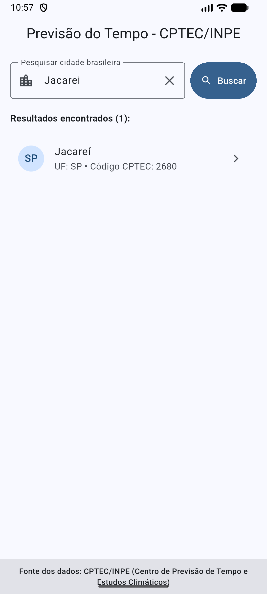
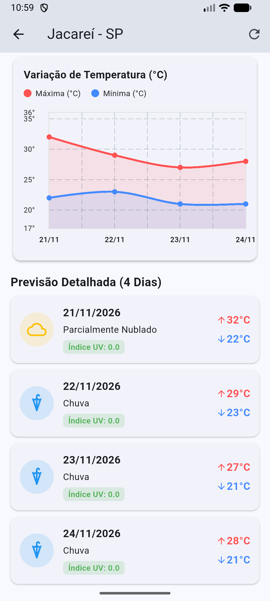
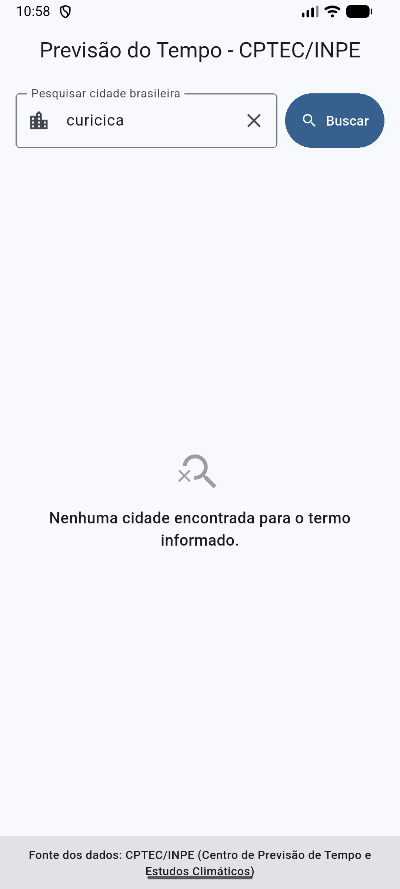

# Previsão do Tempo CPTEC/INPE - Atividade 2 (PDM II)

Aplicativo móvel desenvolvido em Flutter para consulta da previsão do tempo de municípios brasileiros utilizando os web services em formato XML do **CPTEC/INPE** (Centro de Previsão de Tempo e Estudos Climáticos / Instituto Nacional de Pesquisas Espaciais).

## Funcionalidades Implementadas

1. **Pesquisa de Localidades (`listaCidades`)**:
   - Consulta de cidades brasileiras através do parâmetro `city` no serviço do CPTEC/INPE.
   - Normalização automática de caracteres acentuados e descodificação `ISO-8859-1` (Latin-1).
   - Apresentação do nome do município, Unidade da Federação (`UF`) e código identificador oficial da localidade.

2. **Previsão do Tempo para 4 Dias (`previsao.xml`)**:
   - Consulta pelo código identificador retornado pelo serviço.
   - Exibição da data da previsão, temperaturas mínima e máxima em graus Celsius (°C), descrição completa da condição meteorológica traduzida a partir da sigla oficial, ícone ilustrativo e Índice Ultravioleta (IUV), quando disponível.
   - Apresentação da data de atualização dos dados e identificação do **CPTEC/INPE** como fonte oficial.

3. **Gráfico de Temperaturas**:
   - Gráfico de linhas comparativo das temperaturas mínimas e máximas ao longo dos 4 dias previstos.

4. **Atualização e Tratamento de Erros**:
   - Ação de atualização manual (botão na barra superior e gesto _pull-to-refresh_).
   - Indicador visual de carregamento durante as requisições HTTP.
   - Mensagens informativas para buscas sem resultados, falhas de conectividade, timeouts, indisponibilidade do servidor, respostas XML malformadas e ausência de previsão ou de campos opcionais.

5. **Navegação e Persistência Local**:
   - Navegação estruturada entre a tela de pesquisa/histórico e a tela de detalhes/gráficos da previsão.
   - Armazenamento local das cidades consultadas recentemente e cache da previsão do tempo.

## Bibliotecas Utilizadas

- [`http`](https://pub.dev/packages/http): Realização das requisições HTTP GET aos endpoints do CPTEC/INPE.
- [`xml`](https://pub.dev/packages/xml): Interpretação e extração de dados das respostas no formato XML.
- [`shared_preferences`](https://pub.dev/packages/shared_preferences): Persistência local de dados chave-valor no dispositivo.
- [`fl_chart`](https://pub.dev/packages/fl_chart): Renderização do gráfico de linhas de variação térmica (mínima e máxima).

## Estratégia de Persistência Local

A persistência local foi implementada na classe `StorageService` utilizando o pacote `shared_preferences` com serialização em JSON em duas frentes complementares:

1. **Histórico de Cidades Consultadas (`cidades_recentes_v1`)**: Sempre que o utilizador seleciona uma localidade nos resultados da pesquisa, o seu objeto (`id`, `nome` e `uf`) é persistido numa lista local ordenada pelas consultas mais recentes (limitada às últimas 10 localidades sem duplicações). Isto permite aceder diretamente à previsão das cidades habituais no ecrã inicial sem repetir a pesquisa textual.
2. **Cache de Previsão por Localidade (`cache_previsao_{id}`)**: Sempre que a previsão de 4 dias de uma cidade é obtida com sucesso a partir do CPTEC/INPE, o modelo completo `PrevisaoCidade` é guardado localmente associado ao identificador da cidade. Caso o dispositivo fique sem ligação à internet ou o servidor do CPTEC apresente instabilidade numa consulta futura, a aplicação recupera e exibe os dados persistidos em cache, alertando o utilizador sobre o modo offline.

## Instruções para Executar o Projeto

### Pré-requisitos

- Flutter SDK (versão 3.0 ou superior) instalado e configurado.
- Emulador Android, dispositivo físico ou navegador Chrome.

### Passo a passo

1. Clone este repositório:
   ```bash
   git clone <URL_DO_SEU_REPOSITORIO>
   cd previsao_tempo_cptec
   ```
2. Instale as dependências do projeto:
   ```bash
   flutter pub get
   ```
3. Execute a aplicação no emulador ou dispositivo conectado:
   ```bash
   flutter run
   ```

## Capturas de Tela das Principais Funcionalidades

- 

- 

- 
